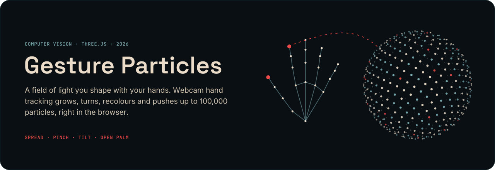
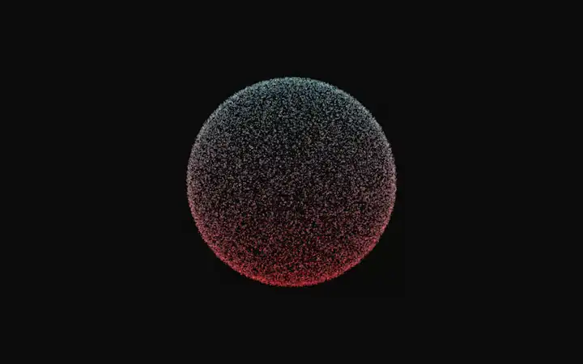
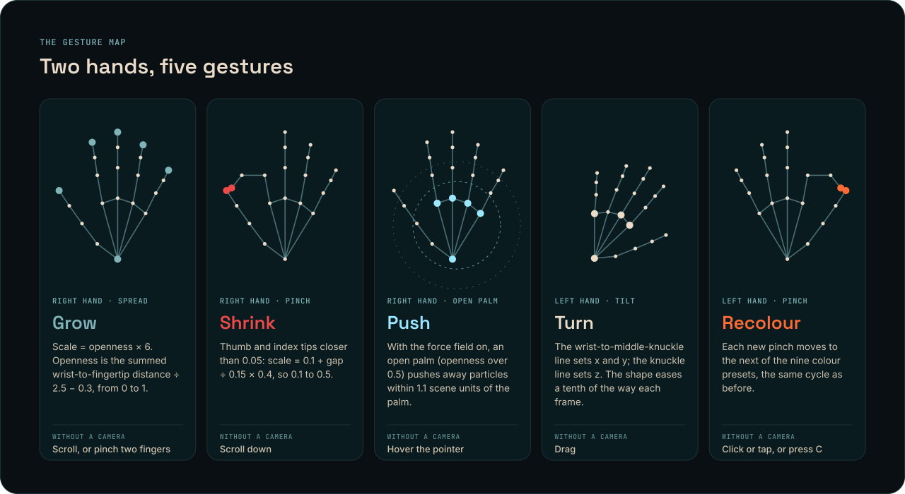
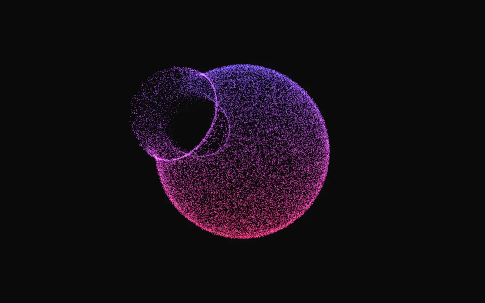
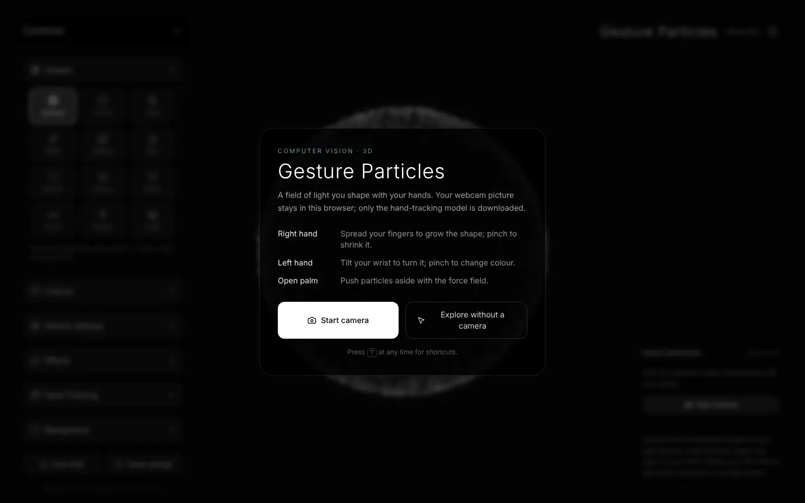
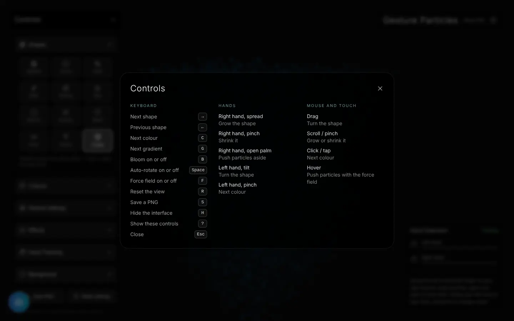
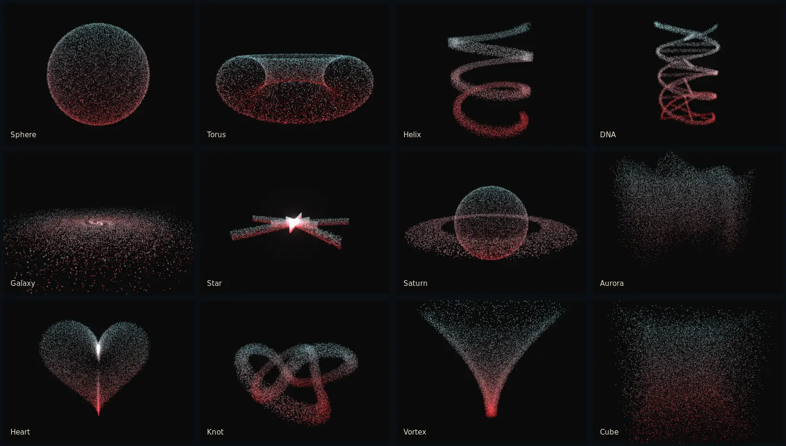
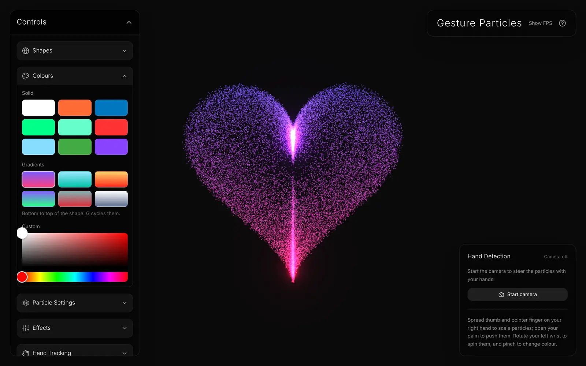
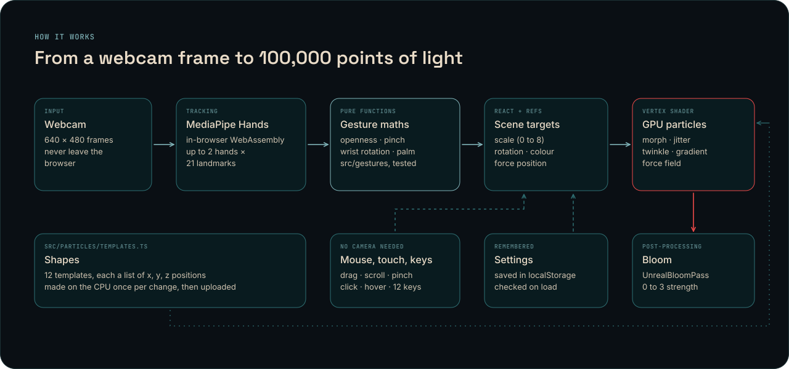

<p align="center">
  <a href="https://gesture-particles.rayhanson.tech/"></a>
</p>

<p align="center">
  <a href="https://gesture-particles.rayhanson.tech/"></a>
  <a href="https://github.com/Rayhanson-Git/Gesture-Particles/actions/workflows/ci.yml"></a>
  
  
  
  
  
</p>

<p align="center">
  <a href="#about">About</a> ·
  <a href="#gestures">Gestures</a> ·
  <a href="#without-a-camera">Without a camera</a> ·
  <a href="#the-control-panel">Control panel</a> ·
  <a href="#how-it-works">How it works</a> ·
  <a href="#privacy-and-network">Privacy</a> ·
  <a href="#run-it-locally">Run it locally</a> ·
  <a href="#status-and-limits">Limits</a> ·
  <a href="#changelog">Changelog</a>
</p>

## About

Gesture Particles connects webcam hand tracking to a three-dimensional cloud of light. Instead of reaching for a
slider, you change the scene with your hands: spread your right hand and the shape grows, pinch and it shrinks, tilt
your left wrist and it turns, pinch with your left hand and it changes colour. Open your right palm and the particles
part around it.

Twelve shapes, from a sphere and a galaxy to a trefoil knot and a heart, morph smoothly into one another. The particles
run on the GPU, so the cloud can hold up to **100,000** of them, and a bloom pass makes them glow. Everything also works
with a mouse, a touch screen or the keyboard, so you can explore it without a camera at all.

<p align="center">
  <a href="https://gesture-particles.rayhanson.tech/"></a>
</p>

<p align="center"><sub>Recorded from the app in a headless browser, driven with the keyboard and the pointer. Shown at 1.7× speed.</sub></p>

## Gestures

<p align="center">
  
</p>

| Hand | Gesture | What happens |
|---|---|---|
| **Right** | Spread your fingers | The shape grows. Its scale is the hand's openness × 6, so 0 for a fist up to 6 for a wide-open hand. |
| **Right** | Pinch thumb and index | The shape shrinks: while the tips are closer than 0.05, scale runs from 0.1 to 0.5 with the gap. |
| **Right** | Open your palm | With the force field on, particles within 1.1 scene units of your palm are pushed aside. |
| **Left** | Tilt your wrist | The shape turns to follow your wrist, easing a tenth of the way there each frame. |
| **Left** | Pinch | Each new pinch moves to the next of the nine colour presets. |

The scale is always capped at 8. Either hand can be switched off in the panel, which is handy when you record: a
switched-off hand changes nothing, its pinch included.

<p align="center">
  
</p>

<p align="center"><sub><b>The force field.</b> An open right palm, or the mouse pointer when no hands are in view, opens a hole that follows it.</sub></p>

## Without a camera

Choose **Explore without a camera** on the start screen, or simply never start it.

| Input | What it does |
|---|---|
| **Drag** | Turns the shape. |
| **Scroll**, or **pinch** with two fingers | Grows or shrinks it, between 0.1 and 8. |
| **Click** or **tap** | Next colour, like a left-hand pinch. |
| **Hover** | The force field follows the pointer. |

| Key | Action | Key | Action |
|---|---|---|---|
| <kbd>→</kbd> <kbd>←</kbd> | Next or previous shape | <kbd>F</kbd> | Force field on or off |
| <kbd>C</kbd> | Next colour | <kbd>R</kbd> | Reset the view |
| <kbd>G</kbd> | Next gradient | <kbd>S</kbd> | Save a PNG of the scene |
| <kbd>B</kbd> | Bloom on or off | <kbd>H</kbd> | Hide the interface |
| <kbd>Space</kbd> | Auto-rotate on or off | <kbd>?</kbd> | Show every control |

<table>
  <tr>
    <td width="50%"></td>
    <td width="50%"></td>
  </tr>
  <tr>
    <td align="center"><sub><b>The start screen.</b> Nothing downloads and no camera opens until you choose.</sub></td>
    <td align="center"><sub><b>Press <kbd>?</kbd></b> for every control in one place.</sub></td>
  </tr>
</table>

## The control panel

<p align="center">
  
</p>

| Section | What it holds |
|---|---|
| **Shapes** | Twelve: Sphere, Torus, Helix, DNA, Galaxy, Star, Saturn, Aurora, and the new Heart, Knot, Vortex and Cube. A new shape morphs in over 1.4 seconds. |
| **Colours** | Nine solid presets (the cycle a left pinch steps through), six gradients that run from the bottom of the shape to the top (Dusk, Lagoon, Ember, Borealis, Rayhanson, Moonlight), and a colour picker. |
| **Particle Settings** | Density from 5,000 to 100,000 in steps of 5,000 (15,000 to start), size, opacity, and a pulse. |
| **Effects** | Bloom and its strength (0 to 3), the force field, and auto-rotate at −3 to 3. |
| **Hand Tracking** | Switch each hand on or off, and show or hide the markers that follow your hands in the scene. |
| **Background** | Any colour. |

**Save PNG** downloads the current frame. Every setting is remembered in your browser; **Reset settings** brings back
the defaults.

<p align="center">
  
</p>

## How it works

<p align="center">
  
</p>

**Tracking.** When you start the camera, the app loads MediaPipe Hands, Google's hand-tracking model compiled to
WebAssembly, and feeds it 640 × 480 frames. For each frame it returns up to two hands, each as 21 landmarks: the wrist
and four points along every finger, in the picture's own 0-to-1 coordinates.

**Gesture maths.** [`src/gestures/handMath.ts`](src/gestures/handMath.ts) turns landmarks into plain numbers, with no
DOM and no MediaPipe involved, so it is covered by unit tests with synthetic hands:

- **Openness** is the summed distance from the wrist to all five fingertips, divided by 2.5, minus 0.3, kept between 0
  and 1. Over 0.5 counts as an open hand.
- **Pinch** is thumb tip to index tip, in 3D, under 0.05.
- **Rotation** comes from two lines: wrist to middle knuckle (x and y) and index knuckle to pinky knuckle (z).
- **Handedness.** MediaPipe's classic Hands build labels hands as if the picture were mirrored. The camera feed here is
  not, so its "Left" is your right hand. That swap lives in one function, `personHand`, with a test of its own, and it
  was checked against the model itself: MediaPipe's own photo of two left hands comes back labelled "Right" from the
  pinned build, so the swap gives the right answer.
- **Mirror view.** The camera preview, the rings that follow your hands and the force field are all shown as a mirror,
  like any selfie camera: move your right hand to the right and they move right with it.

**Particles.** Each shape is a list of x, y, z positions, made once when you pick it. They go to the GPU, and a vertex
shader does the rest every frame: it blends from the old shape to the new one (with a small burst halfway), adds a
gentle jitter and a twinkle to every particle, colours it along the gradient, and pushes it out of the force field.
The material is Three.js's own `PointsMaterial`, extended with `onBeforeCompile`, so the soft round sprite, the size
falling off with distance and the additive glow are exactly what they were before the move to the GPU. The shape's
scale and rotation are a single transform on the whole cloud. An `UnrealBloomPass` adds the glow.

**One set of targets.** Hands, the mouse, touch and the keyboard all steer the same targets: a scale, a rotation, a
colour and a force position. The scene eases towards the scale and rotation a tenth of the way each frame, and the force fades in and out, so every input feels the same.

## Privacy and network

The camera picture is processed in your browser and is never uploaded or stored. There are no accounts, no analytics
and no cookies.

| What | Where | When |
|---|---|---|
| The app itself | The site you load it from | On every visit. |
| MediaPipe Hands 0.4.1675469240 and its camera helper 0.3.1675466862 (scripts, WebAssembly and the model) | jsDelivr (`cdn.jsdelivr.net`) | Only after you choose **Start camera**. Versions are pinned in [`src/tracking/mediapipe.ts`](src/tracking/mediapipe.ts). |
| Your settings | Your browser's `localStorage` (`gesture-particles:settings:v1`) | Whenever a setting changes. They never leave the device. |

## Run it locally

You need Node.js 20 or later.

```bash
git clone https://github.com/Rayhanson-Git/Gesture-Particles.git
cd Gesture-Particles
npm ci
npm run dev
```

Then open the address Vite prints (it ends in `/Gesture-Particles/`). Browsers only allow the camera on `localhost`
or over HTTPS.

```bash
npm test            # 51 unit tests: gesture maths, shapes, morphing, colours, settings, tracking results
npm run typecheck
npm run lint
npm run build       # the static site, in dist/
npm run check       # all four, as CI runs them
```

## Project layout

```text
src/
  App.tsx                  settings, shortcuts, and the overlays
  gestures/                handMath.ts: every gesture rule, plus the synthetic hands and tests
  tracking/                useHandTracking.ts (camera, MediaPipe, preview), mediapipe.ts (pinned loader), statusText.ts
  particles/               ParticleSystem.ts (GPU particles), templates.ts (12 shapes), morph.ts, colors.ts
  settings/                defaults, validation and localStorage
  components/              ThreeScene, the control panel, start screen, help, hand panel, camera preview, FPS
  useShortcuts.ts          keyboard shortcuts and Reduce Motion
public/favicon.svg         the tab icon
assets/                    README images; design/ holds the script that draws the SVGs
.github/workflows/         ci.yml (checks every push) and deploy.yml (GitHub Pages, from main)
```

The illustrations are drawn by [`design/artwork.mjs`](design/artwork.mjs) in the Rayhanson palette, with every word
turned into outlines so GitHub shows them exactly. The hands in them are the same synthetic hands the tests use. The
screenshots and the recording come from the real app in a headless browser.

## Status and limits

- **A fist reads as a pinch**, because the thumb rests on the index fingertip, so a closed right hand shrinks the shape
  to its smallest.
- **It uses MediaPipe's classic Hands build.** Google now recommends its newer Tasks API; moving to it would change
  the model and needs testing with a real camera, so it has not been done yet.
- **It needs WebGL.** Very high densities with bloom need a capable GPU; the FPS meter (top right) shows how a device
  copes. With **Reduce motion** turned on in your system settings, shapes swap without morphing and the twinkle stops.
- **Hand tracking itself has no automated test.** The gesture maths does; the camera path was checked with a
  simulated camera, which has no hands in it.

## Changelog

**2.0, November 2026.** The gestures, the shapes and the defaults of the March 2026 version are unchanged; everything
below was added or fixed around them.

New:

- **GPU particles.** The per-particle work moved from a JavaScript loop into a vertex shader, so density now goes to
  **100,000** (it was 25,000) and the position buffer is no longer uploaded every frame.
- **Morphing.** Shapes flow into each other over 1.4 seconds instead of jumping.
- **Four new shapes:** Heart, Knot, Vortex and Cube (12 in all).
- **Gradients:** six two-colour palettes that run up the shape, with <kbd>G</kbd> to cycle them.
- **Force field:** an open right palm, or the pointer, pushes particles aside. Switch it with <kbd>F</kbd>.
- **No camera needed:** drag to turn, scroll or pinch to scale, click to recolour.
- **Keyboard shortcuts** and a help overlay (<kbd>?</kbd>).
- **Save PNG**, and settings that are remembered between visits, with a reset.
- **A start screen** that explains the gestures and only asks for the camera when you choose, with clear messages
  when the camera is blocked, missing, busy or tracking fails to load.
- Unit tests (51), CI on every push, and `npm run check`.

Fixed:

- The **Bloom Glow** switch did nothing: the render loop read the setting once, when the page loaded.
- Raising **Density** above the starting count broke particles, because their random offsets were sized only once.
- Switching a hand off in the panel still let its pinch change the colour.
- The FPS meter sat on top of the Hand Detection panel, and its loop never stopped once started.
- The camera preview canvas was resized, and so cleared, on every frame.
- MediaPipe loaded from unpinned `<script>` tags on every visit; it is now pinned and loaded on demand.
- The page used a placeholder title, a missing icon and a stock social image.
- The camera preview, the hand rings and the force field were drawn unmirrored, so moving your right hand right
  moved them left. They now behave like a mirror.

Removed: unused dependencies (Supabase, `postprocessing`, two MediaPipe packages), an unused control panel and unused
gesture detectors, and the editor metadata in `.bolt/`.

## Credits

Made by Harvey Rayhanson ([rayhanson.tech](https://rayhanson.tech)) with [React](https://react.dev),
[Three.js](https://threejs.org) and [MediaPipe Hands](https://github.com/google-ai-edge/mediapipe). Its sibling is
[Virtual Theremin](https://github.com/Rayhanson-Git/Virtual-Theremin), which turns hand movement into sound. No licence
has been chosen for this repository, so all rights are reserved.
